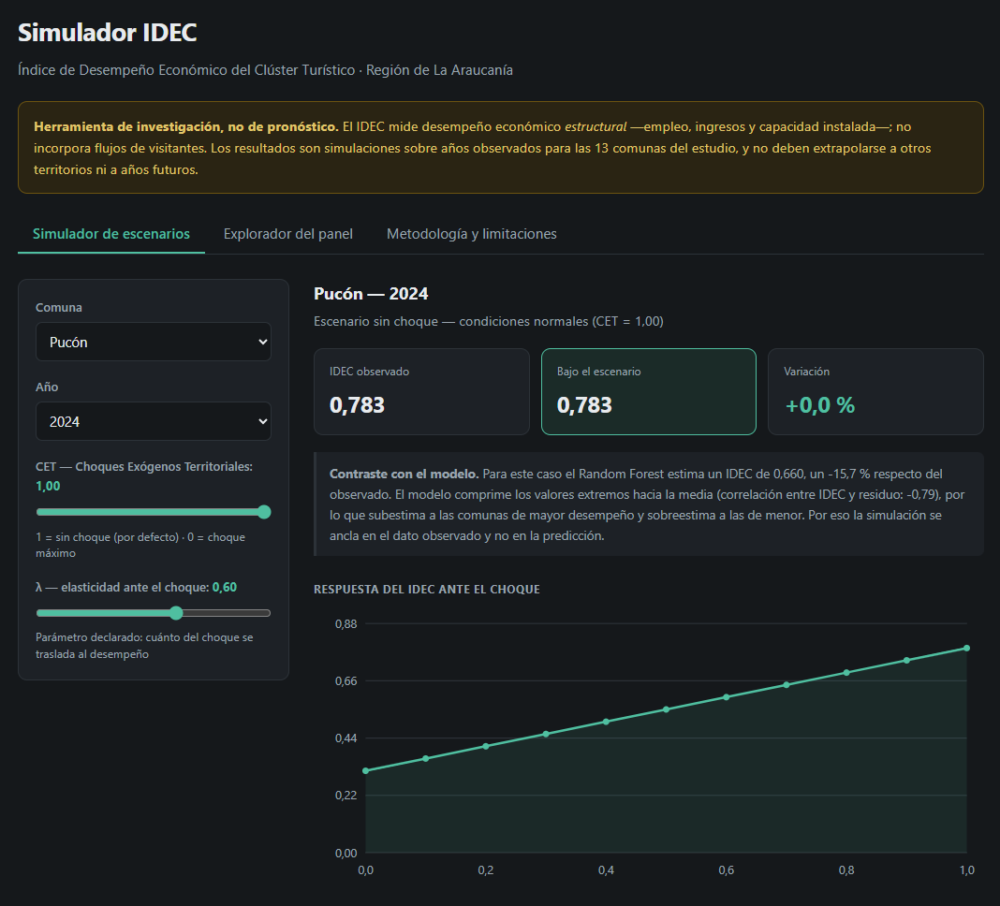
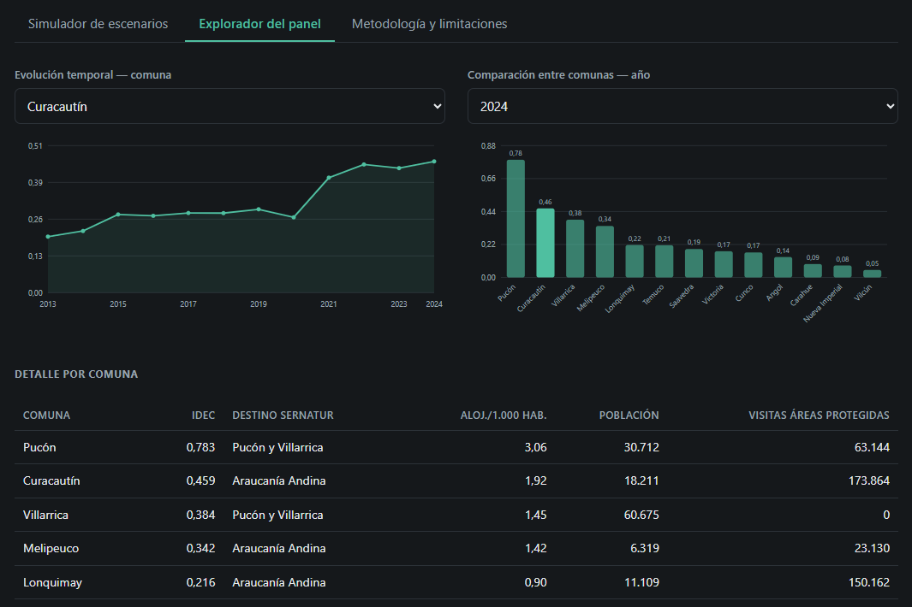

# Modelación del Desempeño Económico del Clúster Turístico de la Región de La Araucanía mediante Técnicas de Machine Learning

> **Investigación Doctoral** · Doctorado en Ciencias Económicas Empresariales
> TECH Universidad Tecnológica · Santiago, 2026

[](https://huggingface.co/spaces/diegoevans2-arch/idec-araucania)

**▶ [Simulador interactivo del IDEC](https://huggingface.co/spaces/diegoevans2-arch/idec-araucania)** — consulte el desempeño de cada comuna y simule escenarios de choques exógenos territoriales.

---

## Resumen

Esta investigación aplica técnicas de Machine Learning supervisado y no supervisado para modelar y evaluar el desempeño económico del clúster turístico de la Región de La Araucanía (Chile), utilizando exclusivamente datos públicos oficiales. El estudio introduce el **IDEC** (*Índice de Desempeño Económico del Clúster*), un indicador compuesto construido **a nivel comunal** a partir de registros administrativos observados. La hipótesis central postula que los modelos de ML logran una precisión predictiva superior a los enfoques econométricos tradicionales, generando evidencia accionable para la toma de decisiones territoriales.

---

## Ficha del Estudio

| Atributo | Detalle |
|---|---|
| **Autor** | Germán Patricio Barra Ávila |
| **Director** | Dr. Alejandro Héctor Molina |
| **Institución** | TECH Universidad Tecnológica |
| **Programa** | Doctorado en Ciencias Económicas Empresariales |
| **Área de estudio** | Región de La Araucanía, Chile |
| **Unidad de análisis** | Comuna × año (panel) |
| **Comunas del clúster** | 13 (núcleo de 8 + anillo de 5) |
| **Período del panel** | 2013 – 2024 (156 observaciones) |
| **Fuentes de datos** | SII · BIP · INE · SERNATUR · CONAF |
| **Paradigma** | Positivista · Cuantitativo · Explicativo-Predictivo |
| **Simulador** | [huggingface.co/spaces/diegoevans2-arch/idec-araucania](https://huggingface.co/spaces/diegoevans2-arch/idec-araucania) |
| **Entrega final** | 10 de diciembre de 2026 |

---

## Pregunta de Investigación

> *¿En qué medida la aplicación de técnicas de Machine Learning a datos públicos permite modelar con mayor precisión predictiva que enfoques tradicionales el desempeño económico del clúster turístico de la Región de La Araucanía, para apoyar la toma de decisiones territoriales?*

---

## Definición del clúster

La unidad de análisis es la **comuna**. El clúster turístico se define con un criterio externo y verificable: los **Destinos Turísticos oficiales que SERNATUR** reconoce en su Registro Nacional de Prestadores.

| Grupo | Comunas | Criterio |
|---|---|---|
| **Núcleo** (8) | Pucón, Villarrica · Curacautín, Lonquimay, Melipeuco · Temuco, Nueva Imperial, Carahue | Destino SERNATUR |
| **Anillo** (5) | Cunco, Victoria, Angol, Saavedra, Vilcún | Oferta formal ≥ 4 alojamientos (análisis de sensibilidad) |

El núcleo concentra el 83 % de la oferta formal de alojamiento de la región.

---

## Arquitectura de datos

El principio rector es **no imputar lo que puede observarse**. Las dimensiones del IDEC se construyen sobre registros administrativos comunales observados, no sobre desagregaciones de series regionales.

### Fuentes integradas

| Fuente | Variable | Granularidad | Ventana | Estado |
|---|---|---|---|---|
| **SII** — Estadísticas de empresas por comuna y rubro | Ventas (UF), trabajadores, renta, nº empresas del rubro *I – Alojamiento y servicio de comidas* | **comuna × año** | 2005–2024 | ✅ Integrada |
| **BIP** — Banco Integrado de Proyectos | Inversión pública ejecutada (`EBI_EJECUCION_PRESUPUESTARIA`) | **comuna × año** | 2013–2022* | ✅ Integrada |
| **INE** — Proyecciones de población (base 2017) | Población total y en edad laboral | **comuna × año** | 2002–2035 | ✅ Integrada |
| **SERNATUR** — Registro de alojamientos | Nº y clase de alojamientos | comuna (corte) | snapshot | ✅ Integrada |
| **CONAF** — Visitantes a áreas silvestres protegidas | Visitación por unidad SNASPE | **comuna × año** | 2012–2024 | ✅ Integrada |
| **EMAT** — Encuesta Mensual de Alojamiento | Llegadas, pernoctaciones, ADR, RevPAR | región | 2017–2026 | ❌ Sin desagregación comunal |

\* El BIP reporta la ejecución con 2–3 años de rezago; se emplean versiones rezagadas (`lag2`) y de stock de capital, que cubren hasta 2024.

### El riesgo evitado: el panel degenerado

Desagregar una serie regional multiplicándola por un peso comunal fijo produce un panel de **rango 1** que no contiene información comunal nueva: el clustering sólo recupera el ranking de pesos y el índice de Theil queda constante. Toda variable pasa por un **diagnóstico de degeneración** antes de entrar a un modelo (`src/features/diagnostics.py`).

| Variable | Interacción comuna×tiempo | Veredicto |
|---|---|---|
| Inversión pública (BIP, observada) | 0,918 | ✅ OK |
| Renta / trabajadores (SII, observadas) | 0,78 | ✅ OK |
| *EMAT × peso fijo (contraejemplo)* | *0,000 — rango 1* | ❌ Degenerada |

---

## El IDEC

Índice compuesto que agrega indicadores normalizados en dimensiones, y las dimensiones en un índice único de igual ponderación:

$$Z_{kjit} = \frac{\ln(1+X_{kjit}) - \min}{\max - \min}, \qquad D_{kit} = \frac{1}{m_k}\sum_{j} Z_{kjit}, \qquad IDEC_{it} = \frac{1}{K}\sum_k D_{kit}$$

Las variables se normalizan **per cápita** antes de agregar: en niveles, el índice ordenaría las comunas por tamaño demográfico en vez de por intensidad de desempeño.

| Dimensión | Indicadores | Fuente | Estado |
|---|---|---|---|
| **D2 — Empleo sectorial** | trabajadores turísticos p.c. | SII | ✅ Observada |
| **D3 — Generación de ingresos** | ventas p.c., renta p.c. | SII | ✅ Observada |
| **D4 — Capacidad productiva** | alojamientos/1.000 hab., empresas p.c. | SERNATUR + SII | ✅ Observada |
| **D1 — Actividad turística** | llegadas, pernoctaciones, ocupación | EMAT | ❌ No construible |

> El IDEC vigente integra **tres de las cuatro dimensiones** y mide, por tanto, desempeño económico **estructural**. El índice es robusto al método de normalización (correlación de Spearman 0,91–1,00 entre Min-Max, Z-score, rank y Min-Max logarítmico).

**Por qué falta D1.** Se evaluaron nueve esquemas de desagregación de la serie regional EMAT y ninguno resultó válido: los ponderadores con dinámica turística real provienen del SII —la misma fuente de D2 y D3, con correlaciones de +0,54 a +0,83, lo que implicaría doble conteo—, y los independientes del índice carecen de contenido turístico. Se verificó además que la EMAT **sí contempla** apertura por destino turístico, pero la fuente declara que está **suspendida desde abril de 2020**. Detalle en [`Nota_metodologica_D1_desagregacion.md`](Documentación/Nota_metodologica_D1_desagregacion.md).

---

## Principales resultados

Los tres hallazgos se sostienen sobre el panel comunal observado 2013–2024 (156 observaciones, 13 comunas).

### H1 — Relaciones no lineales
Random Forest estima el IDEC con predictores **exógenos** al índice (visitación a áreas protegidas, inversión pública, sectores conexos, demografía). La variable más relevante por importancia de permutación es la **visitación a áreas silvestres protegidas** (0,345), seguida de **construcción** (0,123) e **inmobiliarias** (0,067). La inversión pública (BIP) no muestra señal predictiva detectable.

### H2 — Precisión predictiva
| Modelo | R² (validación temporal) |
|---|---|
| **Random Forest** | **0,809** |
| Árbol de decisión | 0,334 |
| Ridge (regularizada) | 0,243 |
| Regresión lineal | 0,051 |

El ML supera netamente a los modelos lineales en **pronóstico temporal** — y lo hace frente a una línea base competente, no frente a modelos mal especificados. La generalización espacial (predecir una comuna no vista) es intrínsecamente limitada por el bajo número de unidades (13 comunas) y se declara como tal.

### H3 — Desigualdad y agrupamientos territoriales
- **Convergencia del clúster.** El índice de Theil del IDEC cae **53,5 %** entre 2013 y 2024 (σ-convergencia, *p* < 10⁻⁶), confirmada por β-convergencia (β = −0,033, *p* = 0,0002; velocidad ≈ 4 % anual). El motor es el alcance de los destinos de la **Araucanía Andina** (Curacautín +134 %, Melipeuco +111 %), no el deterioro de Pucón.
- **Regímenes de desempeño.** El agrupamiento (selección de *k* por método del codo + silueta convergentes en *k* = 4) identifica cuatro regímenes estables (ARI de remuestreo 0,79), separando el **enclave turístico** (Pucón) del **centro urbano de servicios** (Temuco). Cuatro comunas transitan al alza; ninguna a la baja.

---

## Simulador interactivo

**▶ [Abrir el simulador](https://huggingface.co/spaces/diegoevans2-arch/idec-araucania)** · alojado en Hugging Face Spaces

### Simulador de escenarios



Permite seleccionar comuna y año y ajustar la **variable CET** —Choques Exógenos Territoriales, con 1 como condiciones normales y 0 como choque máximo— junto con la elasticidad λ, para estimar el efecto sobre el desempeño del clúster.

Dos decisiones de diseño visibles en la interfaz. La primera es el aviso permanente de que se trata de una herramienta de investigación y no de pronóstico. La segunda es el bloque **«Contraste con el modelo»**: el Random Forest comprime los valores extremos hacia la media —correlación entre IDEC y residuo de −0,79—, por lo que subestima a Pucón en torno a un 16 %; los escenarios se anclan por eso en el valor observado y la predicción se muestra únicamente como contraste.

### Explorador del panel



Muestra la evolución temporal por comuna, la comparación entre los trece territorios y el detalle con destino SERNATUR, intensidad de oferta, población y visitación a áreas protegidas.

La serie de **Curacautín** deja ver el salto de 2021 que sostiene el hallazgo de convergencia: su IDEC crece 134 % en el período. La tabla también hace visible una limitación documentada del estudio — **Villarrica registra cero visitas a áreas protegidas** pese a ser la segunda comuna en oferta hotelera, razón por la cual la visitación de CONAF se emplea como variable explicativa y no como ponderador de desagregación.

---

## Estructura del repositorio

```
.
├── BBDD/
│   ├── processed/            # paneles intermedios por fuente
│   ├── final/                # panel Nivel A, IDEC y resultados H1–H3
│   └── README.md             # estado y especificación de levantamiento de datos
├── src/
│   ├── config.py             # catálogo comunal, definición del clúster, rutas
│   ├── build_panel.py        # ensamblado reproducible del panel
│   ├── data/                 # loaders: sii, bip, poblacion, sernatur, conaf
│   ├── features/             # diagnostics, inversion, idec, cet
│   └── models/               # supervisado (H1–H2), clustering (H3)
├── deploy_static/            # simulador publicado (HTML/JS autocontenido)
├── deploy/                   # variante Gradio del simulador
├── Notebooks/                # exploración inicial
├── Documentación/            # capítulos, notas metodológicas y entrega
├── requirements.txt
└── README.md
```

Los datos crudos **no se versionan** (volumen y licencia). Viven en una carpeta externa apuntada por `src/config.py`; puede redefinirse con la variable de entorno `TESIS_BBDD_DIR`.

### Reproducir el análisis

```bash
pip install -r requirements.txt
python -m src.build_panel        # genera BBDD/final/panel_nivelA_comunal.csv
```

### Regenerar y republicar el simulador

```bash
python -m deploy_static.generar_datos
python deploy_static/publicar.py --publicar
```

---

## Documentación

| Documento | Contenido |
|---|---|
| [Entrega del componente de ML](Documentación/ENTREGA_a_German_Barra.md) | Resumen de resultados, decisiones a defender y pendientes |
| [Capítulo III — Metodología](Documentación/Capitulo_III_Metodologia.md) | Diseño, fuentes, construcción del IDEC, validación |
| [Capítulo IV — Resultados](Documentación/Capitulo_IV_Resultados.md) | Contraste de las tres hipótesis |
| [Capítulo V — Conclusiones](Documentación/Capitulo_V_Conclusiones.md) | Objetivos, contribuciones, implicancias, líneas futuras |
| [Nota metodológica D1](Documentación/Nota_metodologica_D1_desagregacion.md) | Los nueve esquemas de desagregación evaluados |
| [Referencias metodológicas](Documentación/Referencias_metodologicas.md) | 29 referencias organizadas por método |

---

## Estado de avance

### Componente de Machine Learning — completo

| Componente | Estado |
|---|---|
| Levantamiento de fuentes comunales (SII, BIP, INE, SERNATUR, CONAF) | ✅ |
| Panel comunal integrado 2013–2024 | ✅ |
| Diagnóstico de validez del panel | ✅ |
| IDEC — tres dimensiones observadas | ✅ |
| Modelos supervisados (H1, H2) | ✅ |
| Clustering y desigualdad territorial (H3) | ✅ |
| Variable CET — choques exógenos territoriales | ✅ |
| Redacción e integración de los Capítulos III, IV y V | ✅ |
| Simulador desplegado | ✅ |

### Fuera del alcance de este componente

Corresponden al autor de la tesis:

| Componente | Estado |
|---|---|
| Capítulo II — Marco Teórico | Requiere desarrollo |
| Capítulo I — El Problema | Requiere ampliación |
| Verificación de las referencias en la fuente | Pendiente |
| Anexos e índices de tablas y figuras | Pendientes |

### Mejoras futuras del componente cuantitativo

Ninguna bloqueante. El panel se actualiza de forma mecánica cuando el SII publique el año comercial 2025, previsiblemente a fines de 2026 —difunde con unos dieciocho meses de rezago—. Otras vías: pasos fronterizos (PDI) como señal turística adicional, SERNATUR con fecha de inscripción para dar dimensión temporal a D4, y población comunal base Censo 2024 cuando el INE la publique desagregada.

---

## Stack tecnológico


**Librerías principales:** `scikit-learn` · `pandas` · `numpy` · `scipy` · `pyxlsb` · `pyreadr`

---

## Consideraciones éticas

Este estudio utiliza **exclusivamente datos públicos** sin información personal sensible. Las cifras del SII respetan la reserva tributaria (Art. 35 del Código Tributario): los valores construidos con ≤10 informantes se publican enmascarados y se tratan como faltantes estructurales. La reproducibilidad está garantizada mediante código documentado y fuentes de acceso público.

---

## Cita

```bibtex
@phdthesis{barra2026cluster,
  author    = {Barra Ávila, Germán Patricio},
  title     = {Modelación del desempeño económico del clúster turístico de la Región
               de La Araucanía mediante técnicas de machine learning aplicadas a datos
               públicos para la toma de decisiones territoriales},
  school    = {TECH Universidad Tecnológica},
  year      = {2026},
  type      = {Tesis Doctoral},
  address   = {Santiago, Chile}
}
```

## Licencia

El **código** de este repositorio (`Notebooks/`, `deploy/`) se publica bajo licencia [MIT](LICENSE), © 2026 Diego Evans Pérez Paz.

El **manuscrito de la tesis, sus capítulos y los documentos de evaluación** (`Documentación/`) son obra de Germán Patricio Barra Ávila y de su comité evaluador, se incluyen con autorización del autor y conservan todos los derechos reservados. Los **datos** de `BBDD/` se rigen por los términos de uso de sus organismos de origen.

Ver [NOTICE](NOTICE) para el detalle.

---

---

<p align="center">
  <sub>Investigación Doctoral · TECH Universidad Tecnológica · 2026</sub>
</p>
